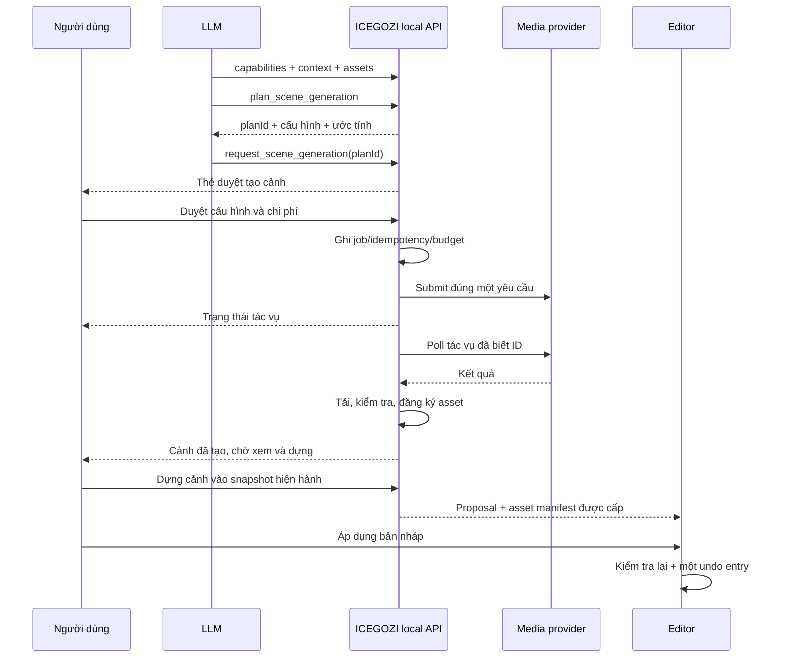

# Prompt triển khai công cụ tạo cảnh AI cho ICEGOZI Video

Ngày khảo sát: **10/10/2026**. Mốc mã nguồn: `573334a` trên `master`.

**Điều chỉnh đã được người dùng xác nhận khi triển khai:** dùng core ICEGOZI để dựng hoạt họa tại máy, dùng Gemini cho ảnh và đăng nhập Google OAuth với cấu hình Google Cloud nhập trong app. Phần đề xuất Runway/asynchronous provider dưới đây là bản khảo sát ban đầu, đã được thay thế. Hợp đồng triển khai và hướng dẫn hiện hành: [SCENE_GENERATION.md](../../SCENE_GENERATION.md). Core tạo clip hoạt họa có chuyển động; Gemini tạo ảnh tĩnh, không phải clip hành động chân thực.

Phần dưới lưu **đề xuất ban đầu để đối chiếu**. Báo cáo khảo sát trước triển khai nằm trong [review tạo cảnh AI](ai-scene-generation-review.md). Yêu cầu này mở rộng phạm vi tạo media vốn được để ngoài MVP trong [prompt tích hợp Codex](codex-local-chatgpt-integration.md); giữ luồng đăng nhập ChatGPT hiện có.

## 1. Nhiệm vụ và kết quả cần đạt

Bạn là kỹ sư senior TypeScript, React, Node.js, SQLite, Remotion và tích hợp công cụ cho LLM. Hãy triển khai công cụ **tạo tư liệu cho cảnh bằng AI** trong repository `icegozi_video`, bao gồm service thật, tool contracts, UI, lưu trữ, tích hợp timeline, kiểm thử và bản đóng gói Windows.

Người dùng coi app là bộ tools để LLM làm video. LLM lập kế hoạch và gọi công cụ có kiểu dữ liệu rõ ràng; app quản lý tác vụ, tài khoản nhà cung cấp, file và quyền áp dụng thay đổi. Skill là hướng dẫn quy trình, service/tool mới thực thi việc tạo media.

Tình huống đích: dự án chưa có clip con cáo. Người dùng nhập **“Tạo cảnh con cáo đang ăn cỏ, 5 giây”**. App có thể tạo một clip mới qua nhà cung cấp hỗ trợ video, cho xem kết quả, đề xuất thêm/thay cảnh và áp dụng qua một lần undo. Khi thiếu kết nối nhà cung cấp, app chỉ rõ cách cấu hình và lựa chọn có thể thực hiện.

Phân biệt ba nhu cầu trong giao diện và hướng dẫn agent:

| Nhu cầu | Cách thực hiện | Kết quả |
| --- | --- | --- |
| Chữ A lớn dần, công thức, title card | Tools dựng cảnh hiện có | Scene Remotion, không cần gọi dịch vụ tạo video |
| Tạo ảnh con cáo, rồi zoom ảnh | Image generation + `ImageScene` | Ảnh tĩnh có chuyển động camera |
| Con cáo thực hiện động tác ăn | Video generation | Clip có chuyển động của chủ thể |

Không đổi yêu cầu tạo hành động thành zoom ảnh rồi báo đã tạo đúng clip. Không tự sửa brief của người dùng; nếu cần làm rõ phong cách hoặc yêu cầu hiện thực, hỏi đúng phần đó. Kết quả AI có thể chưa đạt nội dung mong muốn; việc kiểm tra file thành công không chứng minh động tác được tạo đúng.

Phạm vi MVP gồm tạo ảnh, tạo video từ chữ, tạo video từ một ảnh tham chiếu đã được cho phép, xem trạng thái, hủy, xem kết quả, thêm/thay cảnh bằng proposal và render bằng pipeline hiện có. Clip từ chữ phải có trong MVP vì đó là tình huống người dùng đang thiếu. Chưa mở rộng sang TTS, nhạc, transcription, lip sync, video editing AI tổng quát, huấn luyện model, Electron/Tauri hay framework khác.

## 2. Kiến trúc hiện tại đã xác minh

| Khu vực | File | Nhận xét và hệ quả triển khai |
| --- | --- | --- |
| Tools LLM | `src/application/assistant/editorTools.ts` | Namespace `video_editor`; chưa có tool tạo media; hợp đồng tools có hash để đổi native thread |
| Discovery và instructions | `src/application/assistant/editorCapabilities.ts` | `generation.images` và `generation.footage` đều `false`; schema AI strict và chỉ cho text/formula/image/video |
| Điều phối agent | `src/application/assistant/assistantService.ts` | Kiểm tra profile, conversation, epoch; snapshot; dedup theo call ID; approvals; SSE; 15 phút cho một turn |
| Proposal validation | `src/application/assistant/projectProposals.ts` | Asset mới ngoài `projectAssets(base)` bị chặn; validation chạy cả server lẫn reducer browser |
| Browser state | `src/editor/state/editorStore.tsx` | State editor là nguồn hiện hành; `APPLY_AI_PROJECT_CHANGE` có revision/fingerprint/epoch, locks và một undo entry |
| Frontend assistant | `src/editor/hooks/useAssistant.ts` | Requests có capability header; proposal được server consume trước khi reducer áp dụng, có race mất draft đã tái hiện |
| Assets UI | `src/editor/components/assets/AssetPanel.tsx` | Danh sách được suy ra từ scenes; upload file hiện thêm scene ngay, chưa phải thư viện media độc lập |
| Upload | `src/infrastructure/server/renderApiPlugin.ts` | Stream file vào temp, magic bytes, UUID, containment, atomic rename; chưa ghi registry DB trong handler upload |
| SQLite | `src/infrastructure/db/client.ts`, `schema/assets.ts` | Có `media_assets`, `project_assets`, `render_jobs`; chưa có generation jobs/plans; bootstrap DDL và Drizzle phải cập nhật cùng nhau |
| Kiểm tra media | `src/infrastructure/ffmpeg/FfprobeClient.ts` | Tìm FFprobe qua config/PATH/WinGet; không đủ để bảo đảm hoạt động trên máy Windows sạch |
| Server | `codexApiPlugin.ts`, `productionServer.ts`, `localApiServer.ts` | Dev và production dùng bridge chung; production có static media và byte ranges |
| Đóng gói | `scripts/build-app.ts`, `start-app.ts`, `package-windows.ts` | Có backend Node, Node 24, native Codex/Code Mode host, Chrome và skills; dữ liệu ghi vào workspace của user |
| Skills | `skills/video/*/SKILL.md`, `videoSkills.ts` | Sáu workflow do app sở hữu; loader dùng allowlist ID và kiểm tra realpath |

Đọc toàn bộ các hàm này và callers trước khi sửa. Không chỉ bật hai capability booleans hoặc thêm câu hướng dẫn trong skill. Không sửa file project demo để giả lập việc editor của người dùng đã đổi.

## 3. Nhà cung cấp và xác thực

**Đề xuất mặc định:** dùng adapter Runway cho MVP ảnh/video để giảm số kết nối cần cấu hình. Đặt provider sau interface để có thể bổ sung dịch vụ khác. Lựa chọn này là đề xuất kỹ thuật, chưa chứng minh tài khoản của người dùng có quyền truy cập.

Runway hiện có hướng dẫn tạo video `gen4.5` từ chữ hoặc ảnh và tạo ảnh `gen4_image`. Adapter phải đối chiếu schema, duration, ratio, format, phiên bản API và quyền tài khoản tại thời điểm triển khai; không suy ra parameter hợp lệ chỉ từ tên model. [Runway Getting Started](https://docs.dev.runwayml.com/guides/using-the-api/)

Không xây adapter video mới dựa trên `openai.videos.create` chỉ vì SDK `openai@7.31.0` còn có method đó: tài liệu OpenAI xác nhận Sora 2/Videos API đã đóng ngày **24/09/2026**. [OpenAI Video generation](https://developers.openai.com/api/docs/guides/video-generation)

SIWC hiện dùng cho agent và ChatGPT plan usage; tuyến này không hỗ trợ công cụ image generation. Không dùng `ACCESS_TOKEN` SIWC làm credential cho Image API hay nhà cung cấp media khác. [OpenAI SIWC limitations](https://developers.openai.com/siwc/token-sharing-open-source/preview-limitations)

Nếu bổ sung OpenAI Images sau MVP, dùng credential API riêng do user chủ động cấu hình và Image API chính thức; không thay kết nối ChatGPT bằng API key. [OpenAI Image generation](https://developers.openai.com/api/docs/guides/image-generation)

Yêu cầu cấu hình:

- UI “Nhà cung cấp tạo cảnh” cho nhập/đổi/xóa kết nối. Backend chỉ trả trạng thái, nhãn kết nối và capabilities; không trả secret đã lưu.
- Gửi secret trực tiếp từ form đến endpoint local được bảo vệ. Không đi qua chat, prompt LLM, localStorage, URL hoặc log. Sau khi lưu, xóa giá trị trong state của form.
- Lưu credential bằng Windows current-user DPAPI; có thể tái sử dụng abstraction encryption hiện có nhưng dùng kho riêng cho generation. Định danh `credentialId` và `credentialVersion` không chứa secret.
- Giữ kho credentials ngoài repo và release. Không đọc `.env.local`, không lấy cookie, Codex auth hay credential của app khác làm fallback. Tests dùng fake credentials.
- Bind kết nối với chủ sở hữu local/profile hiện hành. Tách `assistantProfileId` khỏi `providerConnectionId`; đổi tài khoản ChatGPT không được vô tình dùng kết nối tạo cảnh của tài khoản trước.
- Xóa/đổi credential làm invalid các approval chưa gửi. Job đã gửi có thể vẫn chạy và tính phí ở provider; UI phải phản ánh đúng việc mất khả năng theo dõi/hủy. Không tự chạy lại bằng key mới.
- Catalog liệt kê cấu hình được adapter hỗ trợ, không coi việc lưu key hoặc nhìn thấy model là bằng chứng có quota/quyền tạo. Phân loại auth failure, model unavailable, quota và rate limit bằng lỗi thật.

AI generation vẫn cần Internet và quyền/credits của nhà cung cấp. Bản portable phải chạy service, quản lý job và dựng media local mà không cần source repo hoặc Vite; không quảng cáo khả năng sinh clip offline khi chưa đóng gói model local.

## 4. Luồng ứng dụng



Generation không sửa timeline. Duyệt chi phí tạo media và duyệt thay đổi timeline là hai quyết định độc lập. Không tự render project sau khi sinh xong.

Tool request phải trả nhanh với trạng thái chờ duyệt/job ID. Không giữ một native tool call chờ nhiều phút cho cả generation. Worker theo dõi job độc lập với turn; SSE/UI hiển thị tiến trình kể cả turn đã hoàn tất.

Sau generation, người dùng có thể gửi yêu cầu dựng tiếp hoặc bấm “Tạo bản nháp cảnh”. App đọc snapshot mới nhất; nếu cần LLM dựng tiếp, tạo một turn mới từ thao tác này và asset manifest hiện hành. Không âm thầm khởi động inference tính phí khi worker nhận callback. MVP có thể dựng proposal thêm/thay một scene bằng typed service local từ asset đã xác minh.

## 5. Domain và provider adapter

Thêm domain nhỏ cho generation, không nhét logic network vào React hoặc `AssistantService.tool()`:

```ts
type GenerationKind = 'image' | 'video';
type GenerationMode = 'text-to-image' | 'text-to-video' | 'image-to-video';

interface SceneGenerationProvider {
  id: string;
  capabilities(connection: GenerationConnection): Promise<ProviderCapabilities>;
  estimate(request: ResolvedGenerationRequest): GenerationEstimate;
  submit(request: ResolvedGenerationRequest, signal: AbortSignal): Promise<ProviderSubmission>;
  status(submission: ProviderSubmission, signal: AbortSignal): Promise<ProviderTaskStatus>;
  cancel(submission: ProviderSubmission, signal: AbortSignal): Promise<ProviderCancelResult>;
  output(submission: ProviderSubmission, signal: AbortSignal): Promise<ProviderOutput>;
}
```

Đây là interface nội bộ cần định nghĩa đầy đủ, không phải API của SDK. Credentials được inject phía server qua provider context; không có trong request LLM. Adapter chịu trách nhiệm ánh xạ REST/SDK thật và validate response Zod.

`ProviderCapabilities` cần model/preset IDs, modes, combinations hợp lệ của duration/ratio/resolution, reference count/type/byte limits, format, audio support, cancellation và kiểu tiến trình. Không tạo cartesian product cho các tùy chọn mà provider không hỗ trợ đồng thời.

Mỗi preset server-owned gồm provider, model, API version, thông số cố định/cho phép và pricing version. Người dùng chọn preset; LLM không được nhập arbitrary base URL, headers, webhook URL, shell args hoặc object provider options tự do.

Adapter Runway MVP có thể dùng Node fetch hoặc SDK chính thức đã pin version. Nếu SDK có retry mặc định, tắt retry tự động cho submit trả phí. Chưa chứng minh provider idempotency thì không tuyên bố “exactly once” qua mạng. Không dùng `.waitForTaskOutput()` để che mất ID cần ghi vào DB.

Output nên dùng SDR/browser-compatible MP4 cho video và PNG/JPEG/WebP cho ảnh. Chỉ thêm normalization khi cần codec/fps/dimensions thật; giữ source immutable và ghi derivative riêng. Chọn xử lý audio rõ ràng: mặc định cảnh mới im lặng trừ khi người dùng yêu cầu audio và preset hỗ trợ. Không tự trộn âm thanh sinh sẵn vào dự án.

## 6. Tool contracts cho LLM

Thêm tools dưới namespace `video_editor`, tiếp tục trả **JSON string** cho native Code Mode. Schema JSON và Zod runtime phải tương ứng, `.strict()`, giới hạn độ dài/list, không fields tùy ý.

| Tool | Input | Output và tác dụng |
| --- | --- | --- |
| `get_scene_generation_capabilities` | `{}` | Kết nối khả dụng, lý do chưa sẵn sàng, presets/options/limits; không secret |
| `plan_scene_generation` | `kind`, `prompt`, `presetId`, `durationSeconds?`, `referenceAssetIds?`, `intent?` | Tạo plan local; cấu hình đã resolve, estimate, fingerprint, expiry; chưa gọi provider tạo media |
| `request_scene_generation` | `{planId}` | Tạo yêu cầu duyệt; trả `requestId`, `status: awaiting_approval`; lặp cùng plan trả yêu cầu cũ |
| `get_scene_generation_status` | `{requestId}` | Trạng thái plan/job, `jobId?`, tiến trình có nguồn, error code, `assetId?` khi ready; không URL ký của provider |
| `cancel_scene_generation` | `{requestId}` | Từ chối plan chưa gửi hoặc yêu cầu hủy job đã gửi; kết quả hủy có thể pending/unsupported/unknown |
| `list_project_assets` (mở rộng) | `{}` | Manifest gồm asset IDs, local storage keys, loại/metadata/provenance được phép cho project; phải version contract |

`intent` chỉ mô tả cách dựng mong muốn: `placement: append | replace`, `replaceSceneId?`, `timelineDurationSeconds?`, `objectFit: cover | contain`. `replaceSceneId` phải tồn tại, không khóa và không áp dụng tự động. Image plan không nhận duration tạo video; timeline duration của ảnh thuộc intent. Video plan nhận duration theo preset thật; không làm tròn âm thầm sang duration khác.

Giới hạn đề xuất cho MVP: prompt 1–4.000 ký tự, một output mỗi plan, tối đa một ảnh reference cho image-to-video, tối đa 20 jobs trong một hội thoại và hai generation jobs đang hoạt động cho một owner. Đây là giới hạn app, cần cấu hình và kiểm tra server. Duration/resolution phải theo catalog provider, không lấy số giây tự do từ LLM.

Ví dụ input theo một preset được adapter xác minh:

```json
{
  "kind": "video",
  "prompt": "A red fox in a green meadow lowers its head, bites a tuft of grass and visibly chews. One continuous shot, natural daylight, stable camera, no titles.",
  "presetId": "runway-gen45-landscape",
  "durationSeconds": 5,
  "intent": { "placement": "append", "timelineDurationSeconds": 5, "objectFit": "cover" }
}
```

Preset ID ở trên là ID nội bộ đề xuất, không phải model slug hoặc API endpoint. Ví dụ này không đảm bảo chất lượng động tác của output.

Tool outputs có discriminated `status`, `code`, `message`, `retryable`, `nextAction`; không trả full stack/provider body/token. Các lỗi cần phân biệt: `provider_not_configured`, `credential_expired`, `unsupported_request`, `quota_exceeded`, `rate_limited`, `moderation_rejected`, `submission_unknown`, `provider_failed`, `download_failed`, `invalid_media`, `asset_not_ready`, `owner_changed`, `project_conflict`, `approval_expired`.

Owner, profile, project, epoch, snapshot fingerprint và budget policy lấy từ service context. Không nhận chúng từ model như bằng chứng quyền sở hữu. Chỉ server biết khóa, job ID provider và URL download. Tool ID của job do app phát sinh; truy cập job luôn kiểm tra ownership.

Không đổi `list_project_assets` từ `string[]` sang object mà để callers/skills cũ dùng nguyên. Bổ sung trường manifest vào context hoặc một tool mới trong bước chuyển tiếp; cập nhật instructions, tests và toolset hash. Giữ `projectAssets()` là helper lấy các nguồn đang dùng trong timeline.

## 7. Plans, jobs, persistence và trạng thái

Dùng SQLite hiện có, thêm schema/DDL additive, không sử dụng `render_jobs` cho generation. Browser localStorage không phải kho tác vụ dài hạn.

| Bảng | Nội dung tối thiểu |
| --- | --- |
| `generation_plans` | ID, owner/profile, conversation, epoch, project, revision, fingerprint, normalized request/digest, connection ID/version, pricing version, estimate/budget, status, expiry, timestamps |
| `generation_jobs` | ID, plan ID unique, owner/project/conversation, request digest, provider/model/API version, credential reference, provider task ID nullable, state/version, attempts, cancellation flag, lease/nextPollAt, asset ID nullable, lỗi đã sanitize, timestamps |
| `generation_events` hoặc audit tương đương | Job ID, sequence/version, trạng thái, thời gian; dữ liệu nhỏ, bounded retention, không secret/signed URL |
| Registry hiện có | Ghi `media_assets` và `project_assets`; provenance riêng cho generation và grants scoped theo owner/project nếu project tables chưa có ownership |

FK project: project browser mới có thể chưa được autosave SQLite khi LLM lập plan. Nếu job/grant dùng FK `projects.id`, phải đồng bộ project/snapshot qua service hiện có trước transaction tạo plan/job và kiểm tra conflict. Không tự tạo project rỗng hoặc tăng revision chỉnh sửa chỉ để thỏa FK. Hai revision browser/server là hai counters khác nhau.

Nếu cập nhật schema bảng cũ, cần migration version được kiểm thử với DB cũ; `CREATE TABLE IF NOT EXISTS` không thêm column vào bảng đã tồn tại. Index tối thiểu cho owner/project + createdAt, state + nextPollAt, unique plan ID/request identity và provider task identity có scope đúng. Không tạo UNIQUE toàn cục cho provider ID nếu adapter không bảo đảm ID toàn cục.

Plans: `draft -> awaiting_approval -> approved | declined | expired | invalidated`. Đề xuất expiry 10 phút. Approval xác nhận chính request digest, preset, connection version, reference hashes và estimate đã hiển thị. Khi đổi bất kỳ mục nào phải lập plan mới.

Jobs:

```text
queued -> submitting -> submitted -> processing -> downloading -> validating -> ready
                 \-> submission_unknown
any nonterminal -> failed / cancel_requested
cancel_requested -> cancelled / completed_after_cancel / cancellation_unknown
```

`ready` nghĩa là output đã tải xong, kiểm tra thành công, immutable file và asset registry/grant đã có; không chỉ provider báo succeeded. `completed_after_cancel` không đưa scene vào timeline. Phân biệt trạng thái lỗi tạo media với lỗi tải/đăng ký sau khi provider đã thành công.

Không giữ SQLite transaction qua HTTP, polling, hashing hoặc FFprobe. Transaction ngắn cho claim worker, CAS state/version, approve plan + reserve budget + insert job, và commit asset/grant. Ràng buộc DB chặn double-click/hai tabs; Map dedup trong memory chỉ là tối ưu.

Worker chạy một vòng poll nối tiếp có timeout, jitter, backoff và giới hạn số lần/time budget. Runway khuyến nghị poll từ 5 giây trở lên, không dùng interval gây overlapping requests. [Runway SDK/task guidance](https://docs.dev.runwayml.com/api-details/sdks/)

Phải xử lý khoảng trống giữa provider nhận submit và app ghi được task ID:

- Ghi trạng thái `submitting` và request identity trước network call; ghi provider ID ngay khi nhận được, trước bước khác.
- Submit timeout/reset/crash có khả năng đã gửi phải thành `submission_unknown`; không resubmit tự động.
- Khi restart, job có provider ID chỉ được retrieve tác vụ cũ sau kiểm tra owner/credential. Job còn `submitting` mà không có ID chuyển unknown để người dùng kiểm tra.
- Chỉ retry tạo mới từ hành động rõ ràng của user với cảnh báo khả năng job trước vẫn tồn tại. Nếu provider có idempotency/reconciliation chính thức thì adapter mới dùng theo tài liệu đó.
- Các bước status/download có thể retry có giới hạn mà không tạo job media mới. Không biến “tải lại kết quả” thành “tạo lại clip”.

Đổi project không chuyển job sang project mới. Logout/đổi profile invalid approvals, tắt quyền truy cập job của profile cũ và dừng polling local/đề nghị hủy phù hợp; không hứa provider ngừng tính phí. Kết quả về muộn giữ/cách ly theo owner gốc. Restart có thể tiếp tục retrieve tác vụ đã biết ID của owner được xác thực, nhưng không tự submit mới, apply hay khởi động LLM.

## 8. Chi phí và quyền gọi provider

Thẻ approval phải có prompt tóm tắt, loại output, provider/model, duration/ratio/resolution, ảnh tham chiếu được gửi, ước tính credits/tiền và giới hạn cho tác vụ. LLM không quyết định giá hoặc có quyền bấm duyệt.

Ước tính do server tính từ pricing version có nguồn/ngày cập nhật và request đã resolve. Lưu số nguyên theo đơn vị cố định, ví dụ milli-credit/micro-currency; không dùng floating-point money. Không gọi estimate là giá chốt nếu provider không bảo đảm.

Trong transaction duyệt, reserve phần chi phí cho các jobs cùng owner để hai tabs không vượt giới hạn đặt ra. Release/reconcile theo kết quả và policy; timeout/hủy không tự suy ra chi phí bằng 0. Nếu không có pricing đáng tin cậy hoặc không kiểm soát được upper bound, giữ tính năng ở trạng thái cần cấu hình policy; không hiển thị estimate giả rồi submit.

Từ chối approval không có network call tạo media. Hủy không đồng nghĩa hoàn tiền; policy chi phí theo provider cần hiển thị khi liên quan. Chưa có bằng chứng API hỗ trợ hard spend cap thì chỉ mô tả giới hạn app đối với việc submit và estimate.

## 9. Asset ingest và nguồn dữ liệu được phép

Tách một `AssetIngestService` dùng chung ở mức cần thiết cho upload/generation. Giữ tính tương thích API upload; không refactor toàn bộ filesystem chỉ để làm tính năng mới.

Luồng ingest:

1. Provider adapter nhận output từ task mà app đã submit. App không nhận URL download tùy ý từ LLM.
2. Download HTTPS có timeout, max byte, max redirects và giới hạn stream; validate từng redirect/host/IP, chặn loopback/private/link-local/metadata và DNS rebinding. Dùng danh sách domain cụ thể được adapter xác minh; không allow toàn bộ `*.cloudfront.net` chỉ vì một ví dụ có CDN đó. Không chuyển Authorization header sang CDN.
3. Ghi file exclusive vào thư mục temp riêng `generated/temp/scene-generation/<jobId>/`; backpressure, `pipeline`/error/abort handling, disk full và Windows file locks đều phải có kết quả rõ ràng.
4. Validate MIME, magic bytes, decode/probe thực tế, dimensions, codec, duration, max pixels và max output size. Image cần decode được; video cần một video stream hợp lệ và seek/decode được. FFprobe success đơn thuần không chứng minh toàn bộ clip tốt.
5. Hash SHA-256; metadata normalized và source duration/fps thật. Tạo storage key UUID trong `assets/images/` hoặc `assets/video/`, không dùng prompt/filename user làm đường dẫn.
6. Kiểm tra realpath containment chống junction/symlink trước atomic promotion. Giữ file source immutable. Commit registry, provenance và grant trong transaction ngắn.
7. Crash giữa rename và DB commit phải có journal/recovery: file chưa có grant không trở thành asset được LLM dùng. Reconcile owned temp/final files có giới hạn; không xóa asset đang dùng hoặc thư mục của job khác.
8. Trả local key/asset ID, metadata và ready status. Không đưa signed provider URL vào project JSON, browser persistence hoặc prompt.

Runway output URLs có thời hạn; cần tải về storage local thay vì lưu URL đó làm `src`. [Runway Output formats](https://docs.dev.runwayml.com/assets/outputs/)

Không dùng `MediaMetadataReader.enrichAsset()` với hành vi nuốt lỗi và trả asset cũ làm tiêu chí ready. Ingest generation phải fail rõ ràng nếu probe/decode thất bại. Các binaries phục vụ probe/normalization cần đường dẫn bundled riêng và timeout/process cleanup.

Registry hiện có unique theo hash: khi hai jobs cùng bytes, reuse media row trong transaction, nhưng giữ provenance từng job và grant đúng owner/project. Hash giống nhau không cấp quyền đọc asset của owner khác.

Source generated đã ready là media nguồn, không để dưới `PATHS.generated` nơi cleanup có thể xóa. Undo chỉ gỡ scene, không xóa media. GC sau MVP cần tính references từ project/snapshots/undo/proposals/jobs; không thu hồi asset khi chỉ nhìn timeline hiện tại.

## 10. Kết nối asset mới với proposal và editor

Đây là phần bắt buộc ở **cả backend và frontend**. Không xóa điều kiện allowlist trong `validateCandidate()` để cho qua mọi `src`.

Mở rộng policy validation có default giữ hành vi cũ, ví dụ:

```ts
interface CandidateAssetPolicy {
  allowedNewAssetKeys: ReadonlySet<string>;
}
```

Backend tạo set từ registry/grants đã xác minh: owner đúng, project đúng, job ready, file tồn tại, containment/hash/metadata phù hợp. Candidate chỉ được dùng union của assets trong base snapshot và các key trong policy. Không xây set từ candidate hoặc danh sách key LLM khai báo.

Browser giữ asset manifest được cấp qua local capability API trong state riêng với owner/project/epoch binding. Reset manifest khi đổi project/profile/bridge. Shared validator chạy với manifest đã đồng bộ, không tin `assetGrants` tự khai trong candidate. Server vẫn là nơi quyết định quyền, kể cả browser state bị giả mạo.

`VideoProject` và project JSON tiếp tục dùng scene `image`/`video` + local `src`, không thêm scene type executable hoặc nhúng base64. Provenance/metadata lớn nằm registry ngoài project. Có thể có reference asset ID ở proposal DTO với version tương thích dữ liệu cũ.

Flow thêm/thay cảnh:

- Đọc snapshot hiện hành và manifest ready. Build scene có ID mới, `src` từ registry, `durationInFrames = Math.round(seconds * project.fps)`; giữ project ID/metadata/locks.
- Với video, validate offset/playbackRate và duration trên metadata thực. Không cho scene kéo dài qua media end; nếu provider chỉ hỗ trợ độ dài khác, trình bày chọn trim/độ dài khác trước. Không tự loop hoặc slow motion để che clip thiếu.
- Thay scene giữ vị trí timeline và xử lý transition bounds; giữ audio/subtitles ngoài phạm vi yêu cầu. Nếu metadata mới làm transition không fit, trả lỗi có thể sửa.
- Gọi `validate_project_change` rồi `propose_project_change`, hoặc local service tạo cùng proposal contract. Backend và reducer dùng cùng asset policy.
- Asset ready không tăng editor revision. Chỉ apply proposal mới push một history entry; undo/redo, autosave, export/import và renderer đều phải dùng được local key mới.

**Sửa race apply hiện hữu trước khi tái sử dụng cho generated scenes:** `consumeProposal()` hiện xóa draft trước khi browser dispatch; user edit trong lúc HTTP chờ có thể khiến reducer từ chối và draft đã mất. Dùng protocol reserve/ack thay vì consume một lần:

1. Validate và reserve proposal bằng `applyAttemptId`, lease owner/epoch, base fingerprint; trả candidate + manifest, chưa xóa draft.
2. Reducer kiểm tra lại state và ghi applied proposal ID trong cùng mutation lịch sử.
3. Chỉ ack success sau khi frontend quan sát action được áp dụng. Ack/retry idempotent, server xác minh attempt sở hữu lease; không tin thông báo này để bỏ bước validation trước đó.
4. Khi client từ chối, disconnect hoặc lease hết hạn: release reservation, giữ draft để xem/lập lại từ snapshot mới; không apply candidate cũ lên project khác.
5. Hai tabs không đồng thời reserve cùng proposal. Client chỉ áp dụng lease còn hiệu lực; protocol cần handling timeout/recovery khi reducer đã apply nhưng ack mất. Không tự replay reducer sau reconnect.

Có thể thêm route reserve/ack hoặc version endpoint apply, nhưng phải cập nhật callers/tests. Không áp dụng mitigation “giữ draft mãi” trong report như fix hoàn chỉnh mà bỏ qua semantics consume giữa hai tabs.

## 11. Local API, events và UI

Đặt generation routes dưới bridge protected scope, ví dụ `/api/codex/generation/*`, để dùng lại kiểm tra exact Host/Origin và `X-Icegozi-Capability`. Không copy guard yếu hơn hoặc mở một listener ra LAN. Các route của UI và dispatch tools phải gọi chung application service.

Endpoint cần cho connection status/save/delete, plan/request/approval, status/cancel, manifest/result, proposal reserve/ack. Server xác minh owner/epoch trên mọi thao tác. Route save credential không cho LLM gọi; parser/body size nhỏ; không log body.

SSE dùng job ID + sequence/state version; reconnect gửi snapshot authoritative, không replay submits. Poll UI bounded, có AbortController và không overlapping. Event job cũ không cập nhật thẻ của project/profile mới. DTO serialized phải backward compatible khi đọc lịch sử assistant cũ không có generation fields.

UI tái sử dụng `Dialog`, `ConfirmDialog`, `Input`, `Select`, `NumberInput`, `Progress`, `Badge`, `ErrorState`, `Toast`, `ApprovalCard` và `ProposalCard`. Không thêm native `alert()` cho flow mới.

Trong AI Studio, thẻ tạo cảnh cần:

- Brief/preset/reference preview và chi phí trước submit.
- Các trạng thái dễ hiểu: “Chờ duyệt”, “Đang tạo”, “Đang tải”, “Đang kiểm tra”, “Đã tạo”, “Không hoàn tất”, “Đang hủy”. Nếu provider không có phần trăm, dùng tiến trình vô định; không bịa progress.
- Xem ảnh/video đã tạo mà không thêm timeline; nút “Tạo bản nháp cảnh”, “Hủy”, “Tải lại kết quả” hoặc “Tạo lại” đúng trường hợp. Tạo lại là yêu cầu mới cần duyệt chi phí.
- Khi chưa cấu hình, “Kết nối nhà cung cấp tạo cảnh”, giữ brief để người dùng tiếp tục. Không yêu cầu import clip như lựa chọn duy nhất khi capability đã sẵn sàng.
- Thư viện asset thực, gồm media ready chưa có trên timeline; tách draft/job chưa hoàn tất khỏi danh sách media dùng được. Có nhãn “AI tạo”, loại, duration/dimensions và project scope.
- Tôn trọng Vietnamese IME, keyboard, focus/accessibility; layout 1440/768/390. Hạn chế rendering lại toàn bộ chat/timeline khi job tick.

Kết quả preview phải qua local route/asset serve có ownership phù hợp, MIME và Range cho video. `<video>` không tự thêm custom capability header: chọn fetch-to-Blob có giới hạn và revoke khi đổi owner/unmount, hoặc scoped result-serving contract có cùng bảo vệ. Không mở signed provider URL cho browser. Media đã được user chấp nhận vào project dùng asset serving hiện có cho Remotion; không tuyên bố `/assets` hiện là kho riêng có auth theo profile.

## 12. Capabilities và skill đóng gói

Giữ `generation` booleans để callers cũ tương thích, thêm catalog chi tiết riêng: supported/availability/reason, configured connections, valid presets, limits và modes. Chỉ bật `images`/`footage` khi adapter và cấu hình đáp ứng điều kiện chạy; trạng thái này vẫn không hứa entitlement/quota chắc chắn. Không bật voice/music/transcription.

Thêm app-owned `skills/video/icegozi-scene-generation/SKILL.md` và đăng ký trusted ID trong `videoSkills.ts`. Nội dung hướng dẫn: discovery -> phân loại image/video/motion -> plan -> request approval -> status -> ready asset -> fresh snapshot -> validation -> proposal -> human apply. Tiếp tục `JSON.parse` kết quả Code Mode.

Cập nhật workflow/short-video/render-check để phân biệt capability thật, trạng thái công việc và thành công nội dung. Không hardcode “không hỗ trợ AI” sau khi đã cấu hình được provider; cũng không hứa có video chỉ vì skill hiện diện. Không copy skill ChatCut phụ thuộc tài khoản/tools ChatCut hoặc skill trong máy Codex cá nhân vào app.

Đổi toolset hash khi tools/contracts thay đổi, kiểm thử native thread cũ được refresh và chat vẫn còn. Skill version và instructions cũng cần policy invalidation nếu thay đổi ảnh hưởng hành vi mà JSON tool schema không đổi.

## 13. Bản portable Windows

Tận dụng `build:app` và `package:windows`; local generation API phải có trong `productionServer.ts` cùng service với Vite. Không để code chỉ trong `configureServer` của Vite plugin.

- Dependencies provider/worker thuộc production dependencies nếu server bundle để `packages: external`.
- Ship migrations/catalog/skill/adapter resources qua packager allowlist; không dựa vào cwd developer hoặc file không được copy.
- Ship FFprobe và FFmpeg nếu dùng. Resolve bundled absolute paths trước PATH; pin phiên bản, kiểm tra nguồn/license/checksum, thêm notices và smoke check. Có Chrome/Remotion không tự chứng minh `FfprobeClient` tìm được binary trên máy khác.
- Viết generation temp, immutable media, registry DB và jobs vào `ICEGOZI_DATA_DIR`; secrets ở secure user store. Không ghi dưới folder cài app, kể cả khi app nằm ở vị trí chỉ đọc.
- Startup shutdown/dispose worker và child processes; job persisted và reconciled như mục 7. Port conflict xử lý theo launcher hiện có, không kill arbitrary owner.
- Package không có `.env*`, API secret, auth DB, assistant history, local SQLite workspace, media generation của developer hoặc prompt chứa secret.
- Kiểm tra đường dẫn có khoảng trắng/tiếng Việt, chuyển release sang folder khác, chạy với bundled Node 24 và không dùng Vite/Node/FFprobe toàn cục.

Mở rộng `scripts/check-packaged-app.ts` và native `check-code-mode` hoặc checker tương đương: provider fixture local -> plan -> approval -> job -> validated asset -> proposal -> apply/undo -> render MP4 trong package. Fixture chỉ được inject từ test harness/dependency injection; không thêm production bypass auth/cost bằng query flag. Test không gọi provider thật hoặc tiêu credits.

## 14. Kế hoạch triển khai theo dependency

| Bước | Files dự kiến | Kết quả và điều kiện qua bước |
| --- | --- | --- |
| 1. Contracts và scope | `src/domain/generation/*`, `src/schemas/generation.schema.ts`, `src/shared/types/generation.ts` | Typed request/state/errors; provider catalog/spec đã xác minh; không paid call |
| 2. Persistence và secure connections | `db/schema/generation*.ts`, `db/client.ts`, repository/migration helpers, `infrastructure/generation/credentialStorage.ts` | DB cũ nâng cấp được; key không vào renderer/LLM; FK và ownership xử lý |
| 3. Worker + adapter | `application/generation/sceneGenerationService.ts`, `infrastructure/generation/RunwayProvider.ts`, job repository | Approval/budget/idempotency/unknown submit/restart/cancel hoạt động qua fake provider |
| 4. Asset ingest | `application/media/assetIngestService.ts`, registry/grants, metadata/binary config | Download giới hạn và kiểm tra thật; ready có durable file/grant; không source overwrite |
| 5. Proposal handoff | `projectProposals.ts`, `assistantService.ts`, assistant DTO/API, `editorStore.tsx`, `useAssistant.ts` | Asset mới hợp lệ qua cả hai validators; reserve/ack chống mất draft; locks/CAS/undo giữ đúng |
| 6. Tools và discovery | `editorTools.ts`, `editorCapabilities.ts`, dispatcher, `videoSkills.ts`, `skills/video/*` | Native Code Mode gọi tool thật; prompt không nhận secret/URL/file access |
| 7. UI và local API | `codexApiPlugin.ts`, `productionServer.ts`, `AiChatPanel.tsx`, generation cards/provider dialog, `AssetPanel.tsx` | Chat và manual UI gọi chung service; stale events không lẫn project; assets chưa dùng vẫn thấy |
| 8. Package và bằng chứng | scripts build/package/check, tests, `README.md`, `ASSISTANT_INTEGRATION.md` | Portable fixture flow end-to-end, metadata và frames/video thực; giới hạn live access ghi đúng |

Tên files mới là đề xuất; coding agent có thể gom/tách theo code thực tế, giải thích thay đổi khi có lý do. Mỗi bước để lại hành vi chạy được và test phù hợp; không scaffold nhiều provider rỗng hoặc thêm package vì suy đoán.

## 15. Ma trận kiểm thử và acceptance

| Nhóm | Tình huống cụ thể | Kỳ vọng |
| --- | --- | --- |
| Contract | Chữ A lớn dần; tạo ảnh; tạo hành động con cáo | Route đúng typed edit/image/video; không gọi video API cho title card |
| Capability | Key thiếu/sai; preset unsupported; provider unavailable | Lý do thật; không bật capability giả; không submit |
| Cost | Chưa duyệt/từ chối; double-click; hai tabs; expired plan; request/price/key đổi | Chưa duyệt có zero generation submits; một job cho một approval; budget không vượt race |
| Submit ambiguity | Provider nhận nhưng response mất; crash trước persist ID | Unknown status, không tự submit lại; UI phân biệt check/retry |
| Recovery | Restart trước submit/sau submit/sau download/trước DB commit | Không replay charge; dùng task cũ khi có ID; quarantine/reconcile đúng file |
| Cancellation | Before submit; provider running; provider không hỗ trợ cancel; success về sau cancel | Trạng thái chính xác, không tự add scene; không hứa refund |
| Ownership | Job ID của profile/project khác; logout/rotate key; late callback | Từ chối đọc/mutate sai owner, không đổi timeline của project mới |
| File | Redirect/private IP, oversize/chunked, HTML giả MP4, corrupt media, disk full, junction | Không ready/không grant, cleanup owned temp, lỗi usable, app không crash |
| Registry | Cùng hash, DB conflict, file mất sau ready | Dedup có transaction/grant scope; revalidate trước propose/render; không use missing media |
| Proposal | Generated key hợp lệ/bịa key; locked scene; user edit trong apply HTTP; apply twice | Chặn key sai/lock; không mất draft; chỉ một undo khi apply thành công |
| Timing | 24/30/60 fps, trim, playback rate, clip ngắn, crossfade | Frames và source bounds đúng; không kéo qua end hoặc hỏng transition |
| Persistence | DB cũ, lịch sử assistant cũ, project chưa autosave, JSON import/export | Migration additive; defaults tương thích; không ghi đè current project |
| UI | SSE reconnect, unmount, switch profile/project, Blob cleanup, Vietnamese IME | Không stale state/leak preview; không double submit; responsive/a11y |
| Native tools | Runtime thật + fake provider, toolset cũ, JSON string results | Tools gọi được qua native host; old threads refresh; không machine tools |
| Portable | Bundled Node, folder có dấu/khoảng trắng, không global FFmpeg/Vite, installed folder read-only | Ingest/proposal/render hoạt động, data vào workspace, credentials không trong release |

Chạy commands thực có trong repo: `npm run typecheck`, `npm test`, `npm run build:app`, `npm run test:assistant-ui`, `npm run codex:check-tools`, `npm run package:windows`; bổ sung checker generation/portable vào scripts khi triển khai. Kiểm thử fixture không chứng minh quyền tài khoản hoặc chất lượng clip do provider thật tạo.

Acceptance cho ví dụ con cáo:

1. Không có media con cáo trong project; agent vẫn lập được video plan nếu provider configured, không buộc user import trước.
2. Thẻ duyệt hiển thị đúng brief/preset/5 giây/reference/cost; trước duyệt không gọi generate.
3. Sau duyệt có một provider task; trạng thái và ready receipt có bằng chứng. File thực decode được, có metadata và local asset registry/grant.
4. Xem clip trong UI. Kiểm thử fixture xác minh pipeline; đánh giá động tác “ăn” cần xem output thật và được ghi riêng là live content verification khi đã được cho phép dùng provider/credits.
5. Thêm hoặc thay scene bằng draft trên snapshot hiện hành; Apply tăng revision một lần; undo/redo đúng; không tự sửa timeline trước duyệt.
6. Render preview/final theo flow hiện có; MP4 dùng asset mới và seek được trong app đóng gói. Restart/move package không phụ thuộc URL provider hết hạn.
7. Khi thiếu credential hoặc provider từ chối, báo nguyên nhân đúng và giữ brief/project/draft; không báo đã tạo thành công.

## 16. Yêu cầu giao việc cho coding agent

Đọc `MEMORY.md`, repository rules, status và report đi kèm trước khi sửa. Bảo toàn việc của người dùng, không commit/rebase/cleanup ngoài phạm vi. Dùng senior-code-review cho diff cuối, ưu tiên lỗi ownership, charges, persistence, file safety và stale writes.

Triển khai phần local, fake provider, adapters, UI, packaging và tests theo phạm vi được giao. Việc kết nối provider live, dùng tài khoản/credits hoặc chọn phương án khác cần thông tin/quyền tương ứng; không lấy secret sẵn trên máy và không biến test thành paid request.

Khi giao kết quả, nêu files thay đổi, luồng đã kiểm chứng, commands/results, cách cấu hình và dùng, vị trí package/evidence, những mục live chưa chứng minh. Chỉ báo tính năng hoàn tất khi luồng tạo media -> đăng ký asset -> proposal -> apply/undo -> render chạy được trong package; nếu live access chưa có, ghi rõ phần đã hoàn tất bằng fixture và phần chưa kiểm chứng.
