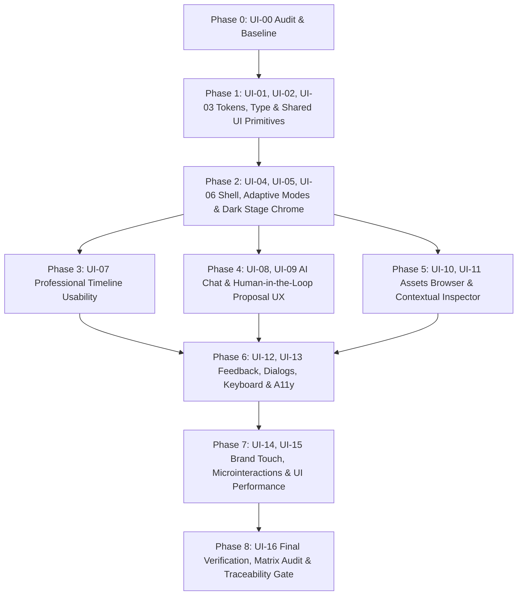

# Kế hoạch Triển khai Master UI/UX Refactor (Luminous Creative Studio)

> **Dự án:** ICEGOZI Video Studio  
> **Phiên bản:** 2.0  
> **Ngày khởi tạo:** 2026-10-10  
> **Mục tiêu:** Nâng cấp toàn diện giao diện từ Phase 0 đến Phase 8 (UI-00 đến UI-16) theo chuẩn enterprise Luminous Creative Studio, đảm bảo tuyệt đối tính toàn vẹn dữ liệu, các quy tắc an toàn Git, Verification Gate và Evidence Contract.

---

## 1. Kết quả Khảo sát Baseline (Phase 0 Audit)

### 1.1 Hiện trạng Kiến trúc Giao diện & Công nghệ
- **Khung ứng dụng:** React 19 + TypeScript + Vite 6 + Remotion 4 + Zod 4 + Drizzle ORM (SQLite).
- **Trạng thái Editor:** Quản lý tập trung qua `editorStore.tsx` (`EditorProvider`, `useEditor`), `editorReducer.ts`, và `useProjectPersistence` (~800ms debounce autosave sang `localStorage` + API `/api/projects`).
- **Giao diện hiện tại:** Đã có nền sáng `#F7F9FC`, thanh lệnh `CommandBar` (50px), `LeftWorkspace` (AI Studio & Assets), `PreviewWorkspace` (khung Remotion Player tối `#0F172A`), `InspectorPanel` (drawer phải), `Timeline` (thước đo, clips, tracks, playhead), và `ExportModal`.
- **Primitives hiện có:** Chỉ có 5 control cơ bản tại `src/editor/components/ui/` (`Button`, `IconButton`, `Input`, `Select`, `Slider`). Rất nhiều màn hình vẫn sử dụng thẻ native `<button>`, `<input>`, `<select>`, `<textarea>` với style inline không đồng nhất.
- **Hệ thống Design Tokens:** `src/editor/tokens/` (`editor.css`, `colors.ts`, `typography.ts`, `spacing.ts`) đã có bảng màu enterprise nhưng còn thiếu các token ngữ nghĩa theo chuẩn mục 4.1 (`--color-app-bg`, `--color-surface`, `--color-surface-muted`, `--color-primary`, `--color-primary-strong`, `--color-text-primary`, `--color-text-secondary`, `--color-border`, `--color-stage`, `--color-creative-accent`), thang spacing, border radius và motion chuẩn.

### 1.2 Kết quả Kiểm tra Baseline Kỹ thuật
- **Typecheck:** `npm run typecheck` — Exit code 0 (Hoàn toàn sạch lỗi kiểu).
- **Unit & Integration Tests:** `npm test` — Exit code 0 (27 test files, 134 vitest tests pass, 41 SIWC checks pass).
- **Build Editor:** `npm run build:editor` — Exit code 0 (Thời gian 6.72s, bundle tạo thành công tại `dist/`).
- **Visual Baseline:** Đã chụp 6 ảnh chụp màn hình thực tế bằng Playwright trên port 3200:
  - AI Focus (1366×768, 1920×1080)
  - Edit Focus (1366×768, 1920×1080)
  - Preview Focus (1366×768, 1920×1080)

---

## 2. Bản đồ Phụ thuộc & Lộ trình Triển khai (Phase Map)

### Chi tiết các Phase:
1. **Phase 0 (UI-00):** Audit mã nguồn, lập ma trận di chuyển component, kế hoạch chi tiết, khởi tạo execution state, thu thập baseline screenshots và kết quả test.
2. **Phase 1 (UI-01, UI-02, UI-03):** 
   - Đồng bộ Design Tokens ngữ nghĩa theo bảng 4.1 trong `tokens.css` và `colors.ts`.
   - Bổ sung typographic scale chuẩn, icon policy và token spacing.
   - Xây dựng thư viện component dùng chung đầy đủ trong `src/editor/components/ui/` (`Button`, `IconButton`, `Input`, `TextArea`, `NumberInput`, `Select`, `Checkbox`, `Switch`, `Slider`, `Tabs`, `Tooltip`, `Dialog`, `ConfirmDialog`, `Toast`, `Badge`, `Progress`, `Skeleton`, `EmptyState`, `ErrorState`, `Separator`, `KeyboardShortcutHint`, `TimecodeInput`).
   - Viết bộ test component bao phủ các trạng thái (disabled, loading, focus, error, keyboard).
3. **Phase 2 (UI-04, UI-05, UI-06):**
   - Thiết kế lại `EditorShell`, `CommandBar`, `LeftWorkspace` với header 56px, command bar 44px, navigation rail trực quan.
   - 3 Focus modes rõ rệt (`AI Focus`, `Edit Focus`, `Preview Focus`), chuyển chế độ không làm thay đổi VideoProject hay chat draft.
   - Khung Dark Stage Chrome căn giữa đúng tỷ lệ khung hình, transport bar chuyên nghiệp.
   - Hỗ trợ responsive 1366×768 và 1920×1080, tấm kéo co giãn mượt mà có min/max an toàn.
4. **Phase 3 (UI-07):**
   - Tối ưu Timeline: ruler rõ ràng, header track cố định, màu track phân định rõ loại (Video, Audio, Subtitle, Text, Formula) kèm nhãn/icon.
   - Playhead chính xác, clip selection rõ nét, handles resize/split mượt mà, zoom & snapping trực quan.
   - Giữ nguyên 100% công thức toán học (crossfade startFrame adjustment, split formula).
5. **Phase 4 (UI-08, UI-09):**
   - Nâng cấp `AiChatPanel`, `PromptComposer`, `ContextChipsBar`, `ProposalCard`.
   - Bảo vệ gõ tiếng Việt Telex/VNI (`isComposing`, `keyCode === 229`).
   - Proposal card trực quan với before/after diff rõ ràng, nút Apply / Reject tường minh.
   - Tích hợp chuẩn xác vào `APPLY_AI_PROJECT_CHANGE` với epoch, revision, SHA-256, Zod schema và 1-click Ctrl+Z undo.
6. **Phase 5 (UI-10, UI-11):**
   - Nâng cấp `AssetPanel` dạng lưới/danh sách nhỏ gọn, hiển thị thumbnail, dung lượng, thời lượng, tìm kiếm lọc.
   - Đảm bảo bảo vệ file nguồn `public/assets` bất biến, không lặp tiền tố `assets/`.
   - Nâng cấp `InspectorPanel` linh hoạt theo clip được chọn (Scene, Formula, Text, Media, Project Settings) với validation tức thời.
7. **Phase 6 (UI-12, UI-13):**
   - Chuẩn hóa Toast thông báo, autosave indicator (`Đã lưu`, `Chưa lưu`, `Đang lưu`, `Lỗi`), render progress & cancellation.
   - Modal accessible focus trap, Esc đóng an toàn, ConfirmDialog cho hành động phá hủy.
   - Phím tắt toàn cục không xung đột khi đang gõ prompt, hỗ trợ bàn phím đầy đủ.
8. **Phase 7 (UI-14, UI-15):**
   - Logo Luminous Studio tinh tế, microinteractions mượt mà (120–180ms), hỗ trợ `prefers-reduced-motion`.
   - Lưu trữ layout preference an toàn (UI-only) không làm tăng project revision.
   - Tối ưu rendering, tránh re-render thừa trong lúc phát video.
9. **Phase 8 (UI-16):**
   - Chạy toàn bộ test suites (`typecheck`, `test`, `build:editor`).
   - Chạy kiểm thử E2E Playwright trên tất cả các viewports (1366×768, 1920×1080), chụp ảnh after.
   - Đối chiếu và hoàn thiện 100% `COMPONENT_MIGRATION_MATRIX.md` sang `MIGRATED` hoặc `EXEMPTED`.
   - Cập nhật `COMMIT_MAP.md` với đầy đủ Git SHAs của các phase.

---

## 3. Danh sách File Trọng tâm sẽ Thay đổi

- `src/editor/tokens/editor.css`
- `src/editor/tokens/colors.ts`
- typography and spacing CSS variables in `src/editor/tokens/editor.css`
- `src/editor/components/ui/*` (mới và mở rộng)
- `src/editor/components/shell/*` (`EditorShell.tsx`, `CommandBar.tsx`, `LeftWorkspace.tsx`, `ResizablePanel.tsx`)
- `src/editor/components/preview/*` (`PreviewWorkspace.tsx`, `TransportControls.tsx`, `CanvasToolbar.tsx`)
- `src/editor/components/timeline/*` (`Timeline.tsx`, `TimelineToolbar.tsx`, `TimelineRuler.tsx`, `TimelineTrackHeader.tsx`, `TimelineClip.tsx`)
- `src/editor/components/assistant/*` (`AiChatPanel.tsx`, `PromptComposer.tsx`, `ProposalCard.tsx`, `ContextChipsBar.tsx`)
- `src/editor/components/assets/*` (`AssetPanel.tsx`)
- `src/editor/components/inspector/*` (`InspectorPanel.tsx`, `TextInspector.tsx`, `FormulaInspector.tsx`, `MediaInspector.tsx`, `ProjectInspector.tsx`)
- `src/editor/components/export/*` (`ExportModal.tsx`)
- `tests/unit/*` & `tests/e2e/*` (bổ sung tests mới cho từng phase)
- `docs/ui-ux/*` (tài liệu quy trình, ma trận di chuyển, evidence)

---

## 4. Quản lý Rủi ro & Nguyên tắc An toàn
- **Bảo vệ dữ liệu:** Không chạm vào schema SQLite, không thay đổi frame math Remotion, không lưu secret vào git hay docs.
- **Git Safety:** Mỗi phase đạt chuẩn `DONE` sẽ được commit cục bộ (local commit) với message theo quy chuẩn Conventional Commits. Tuyệt đối không `git push`.
